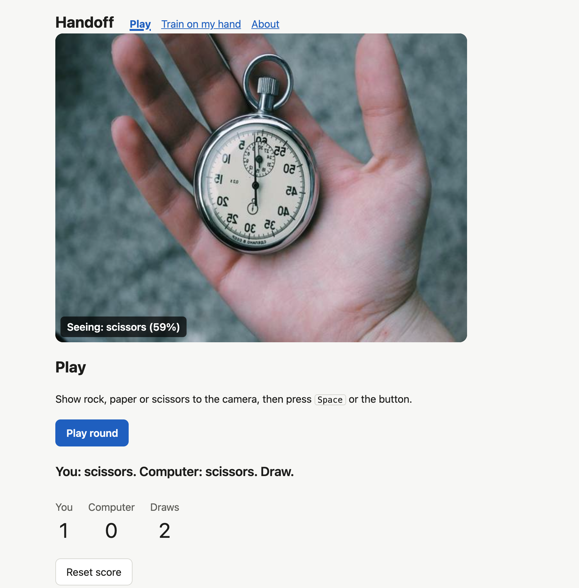
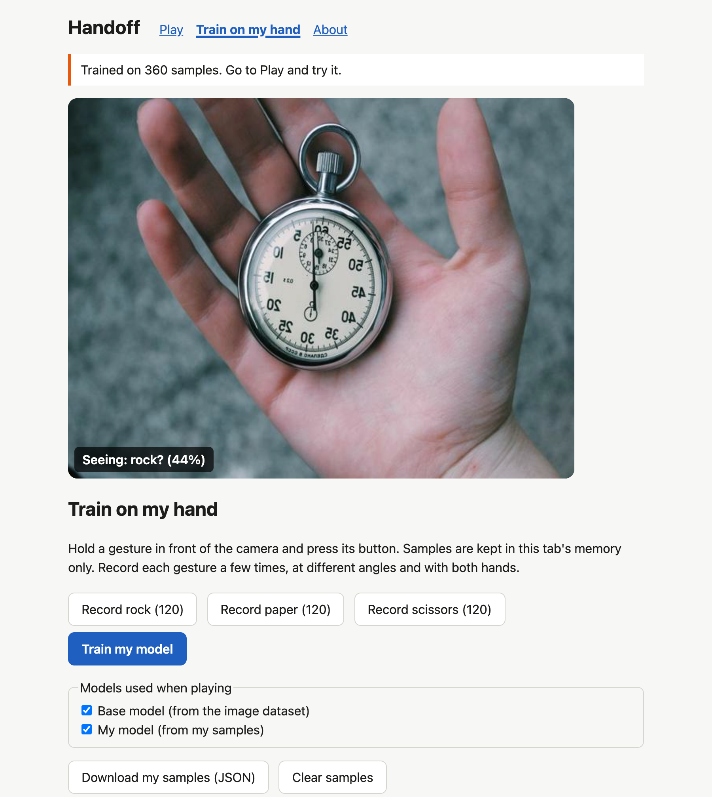
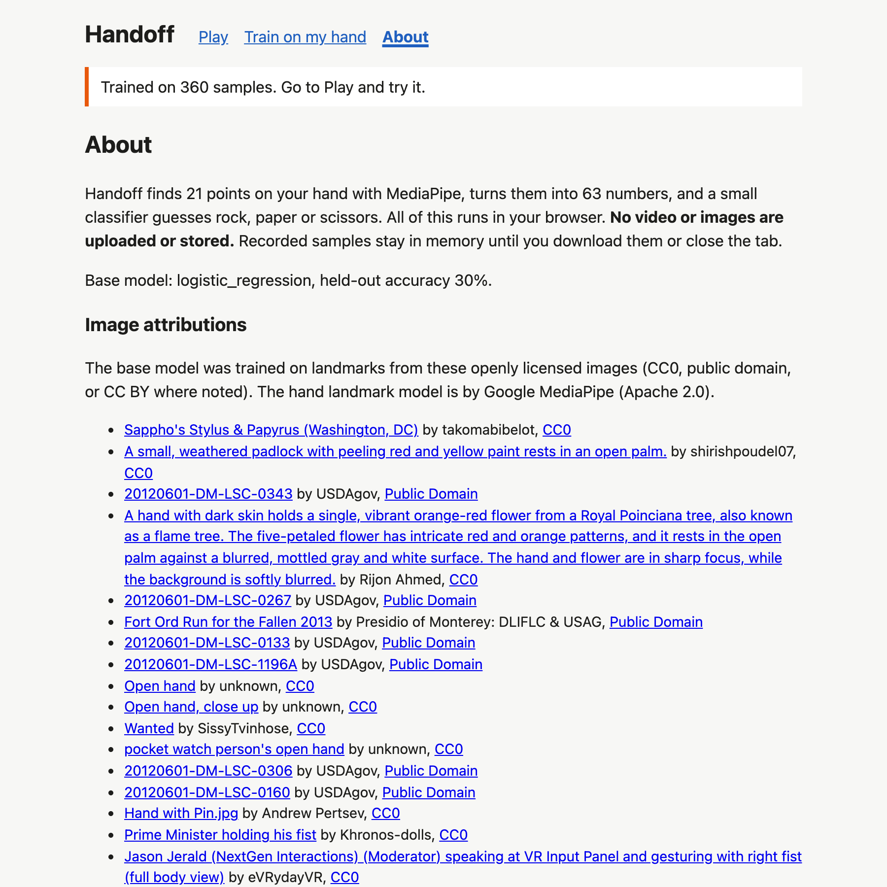
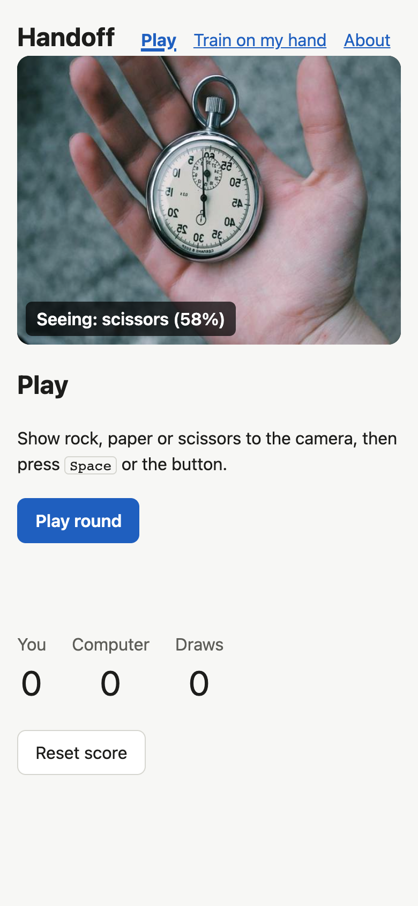
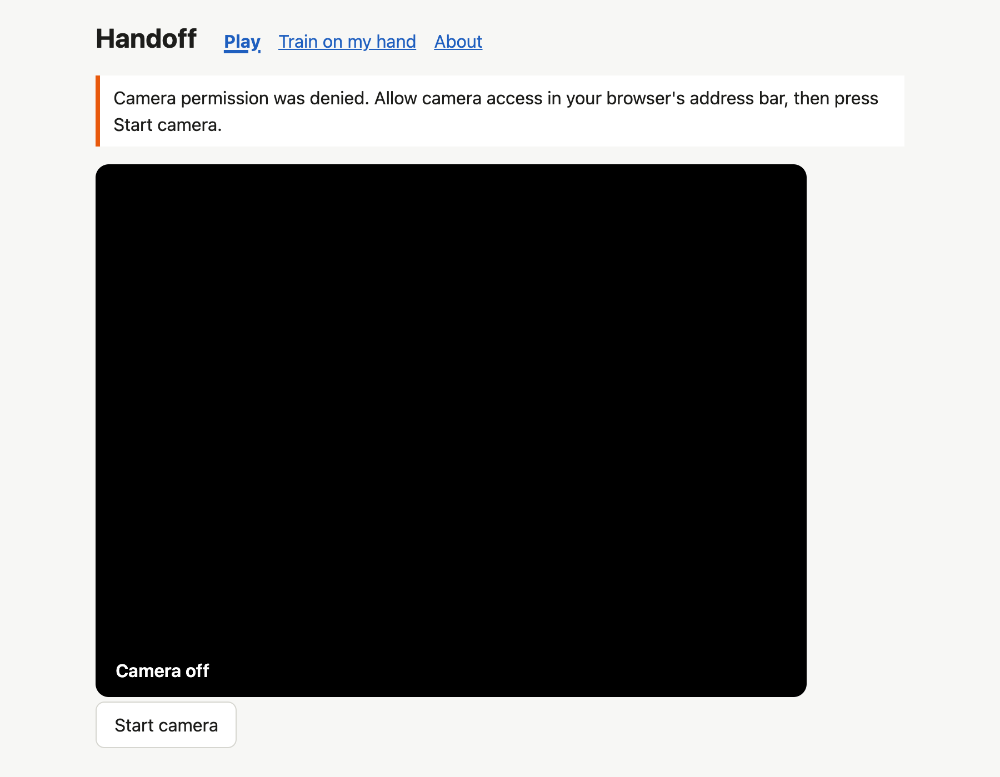

# Handoff: webcam rock-paper-scissors

> **My first machine-learning project.** I built it to learn the whole path end to end: collect
> data, extract features, train and compare models, evaluate honestly, export the model, and run it
> in a web page. It works, but the base model is weak (see [Results](#results)). I kept that in
> the documentation instead of hiding it.

Show rock, paper or scissors to your webcam, press **Play round** (or <kbd>Space</kbd>), and play
against the computer with a running score. Everything runs in your browser: **no video is uploaded
or stored, and there is no backend.**



> The screenshots in this document were taken in headless Chrome with a *photo* standing in for the
> webcam (a CC0 photo of an open palm from the dataset, see [`ATTRIBUTION.md`](ATTRIBUTION.md)).
> The open palm is read as "scissors (59%)": that is the weak base model, not a staged result.

## Contents

1. [Status at a glance](#status-at-a-glance)
2. [Screens](#screens)
3. [Quick start](#quick-start)
4. [Using the app](#using-the-app)
5. [How it works](#how-it-works)
6. [Data policy](#data-policy)
7. [Training and evaluation](#training-and-evaluation)
8. [Results](#results)
9. [Testing](#testing)
10. [Deploying](#deploying-static-site)
11. [Project layout](#project-layout)
12. [Tech stack](#tech-stack)
13. [Troubleshooting](#troubleshooting)
14. [Privacy](#privacy)
15. [Known limitations](#known-limitations)
16. [What I learned](#what-i-learned)
17. [License](#license)

## Status at a glance

| Part | State |
|---|---|
| Web app (play, train on my hand, about) | Works. Tested in headless Chrome with a fake camera; **not tested with a real webcam** |
| Python pipeline (data -> landmarks -> train -> evaluate -> export) | Works end to end |
| Python/JavaScript parity (features and predictions) | Tested, identical to 1e-12 |
| Base model trained on public-domain photos | **Weak: 30% held-out accuracy (chance level)** because only 77 usable images were found |
| In-browser "Train on my hand" k-NN | Works mechanically; accuracy with real hands is untested |

## Screens

| Train on my hand | About and attributions |
|---|---|
|  |  |

| Phone width | Camera permission denied |
|---|---|
|  |  |

Regenerate them with `cd web && npm run build && npm run screenshots -- <any-photo.jpg>`
(needs Google Chrome installed; the photo is used as the fake webcam).

## Quick start

You need:

- **Python 3.12** (or [uv](https://docs.astral.sh/uv/), which `make setup` uses automatically and
  which downloads Python 3.12 for you)
- **Node.js 20 or newer** (comes with `npm`)
- `make` and `curl` (preinstalled on macOS and most Linux; on Windows use WSL)
- A webcam and a recent Chrome, Edge, Firefox or Safari

From the repository root:

```bash
make setup    # creates ml/.venv, installs pinned Python + npm packages, downloads the hand model
make test     # linters + all Python and JavaScript tests
make serve    # starts the site at http://localhost:5173
```

Open http://localhost:5173, press **Start camera**, allow camera access, and play. The repository
already contains a trained `web/public/models/model.json`, so you do not need to download data to
play. To rebuild the model yourself:

```bash
make data     # download images via the APIs, detect hands, write manifest.csv + ATTRIBUTION.md
make train    # compare models, evaluate on a held-out split, export model.json
```

`make data` takes a while on purpose: it waits between requests to respect API rate limits. If a
server rate-limits you, it skips that server for the run; run `make data` again later and it
resumes where it stopped (search results are cached in `ml/data/api_cache/`). Set
`POY_CONTACT=you@example.com` (or your repo URL) before `make data` so the User-Agent carries
contact information, as Wikimedia's robot policy asks.

### All commands

| Command | What it does |
|---|---|
| `make setup` | Python venv + pinned deps, `npm ci`, downloads `hand_landmarker.task` |
| `make data` | acquire images (CC0 / Public Domain only) -> run MediaPipe -> manifest + attribution |
| `make data ALLOW_CC_BY=1` | same, but also keeps CC BY images (credited in `ATTRIBUTION.md`) |
| `make train` | model comparison, evaluation report (`ml/reports/`), export `model.json` |
| `make test` | ruff + pytest, eslint + prettier + vitest (includes the parity test) |
| `make serve` | development server |
| `make build` | static site in `web/dist/` |
| `make fixtures` | regenerate `fixtures/parity.json` (only after changing the feature/model contract) |
| `cd web && npm run smoke` | browser smoke test in real headless Chrome (after `npm run build`; pass a hand photo as the first argument for the full flow) |
| `cd web && npm run screenshots -- <photo>` | regenerate `docs/screenshots/` |

## Using the app

- **Play**: the label on the video says what the model sees (`Seeing: rock (87%)`; a `?` means
  "not sure"). Predictions are averaged over the last 8 frames. Press **Play round** or
  <kbd>Space</kbd>. The computer picks uniformly at random; the score counts your wins, its wins
  and draws.
- **Train on my hand**: the dataset model is weak, so this page lets you record your own samples.
  Press *Record rock* and hold the gesture for 2 seconds; repeat for paper and scissors (a few
  times each, both hands, different angles), then **Train my model**. A k-nearest-neighbours model
  is trained in the page (mirrored copies are added automatically). You can use it alone or
  averaged with the base model (checkboxes). **Download my samples** saves them as JSON on your
  computer. Samples live only in the tab's memory: nothing is sent anywhere.
- **About**: privacy note, base-model accuracy and image attributions.
- **Keyboard**: <kbd>Space</kbd> plays a round (unless a button or link has focus, then it
  activates that control), <kbd>Tab</kbd> moves through controls with a visible focus ring, and
  there is a skip link to the main content.

Messages are shown for: camera permission denied, no camera, camera busy, no hand visible, a hand
that the model is unsure about, missing `hand_landmarker.task`, and missing or invalid
`model.json` (you can still play with your own trained model in that case).

## How it works

```
 OFFLINE (Python, ml/)                                         IN THE BROWSER (web/)

 Openverse API ─┐                                              webcam frame
 Wikimedia API ─┴─> download ─> MediaPipe HandLandmarker           │
                    (CC0/PD)     (keep exactly one hand)            ▼
                                       │                  MediaPipe HandLandmarker (WASM)
                                       ▼                            │ 21 landmarks
                              features.py (63 numbers)              ▼
                                       │                  features.js (63 numbers)  ◄── same function
                       mirror augmentation + grouped split          │
                                       ▼                            ▼
                    logistic regression / MLP / random forest   classifier.js ◄── model.json
                                       │                            │ (+ optional personal k-NN)
                          best exportable model                     ▼
                                       └──────► model.json ──► smoothing (last 8 frames) ─► "Seeing: ..."
                                                                    │ Space / button
                                                                    ▼
                                                              game.js (pure rules) ─► score
```

Two parts share one contract: the **feature function** and the **model file**. They are
implemented twice (Python and JavaScript), and a parity test checks both against the same fixtures.

### Features (the shared contract)

For the 21 MediaPipe hand landmarks `(x, y, z)`: subtract the wrist (landmark 0) from every point,
then divide everything by the largest wrist-to-point distance measured in `x` and `y` only. The
result is 63 numbers in the order `x0,y0,z0,x1,...`. A hand with all points equal gives 63 zeros.
Mirroring a hand means negating every `x`; it is used for augmentation so both hands work.

### Model file (`web/public/models/model.json`, format version 1)

```json
{
  "format": "poy-gesture-model", "format_version": 1, "created": "...",
  "labels": ["paper", "rock", "scissors"],
  "feature_spec": { "name": "wrist_origin_max_xy_distance", "n_features": 63, "version": 1, "...": "..." },
  "model": { "type": "logistic_regression", "coef": [[...63 numbers...], ...], "intercept": [...] },
  "metrics": { "holdout": { "accuracy": 0.30, "per_class": {...}, "confusion_matrix": [...] }, "...": "..." }
}
```

`model` can also be `{ "type": "mlp", "activation": "relu", "layers": [{ "weights": [in][out], "bias": [...] }] }`.
The web app also builds an in-memory `{ "type": "knn", ... }` from your samples. `labels` gives the
order of the output probabilities. Both Python (`export.validate`) and JavaScript
(`classifier.validateModel`) reject files with a wrong format, version or weight shapes. If you
change the features or the file layout, bump the versions in both languages.

### Modules

| Concern | Python (`ml/poy_ml/`) | JavaScript (`web/src/`) |
|---|---|---|
| Config, labels, paths | `config.py` | |
| Data access (one module per API) | `data_sources/openverse.py`, `data_sources/wikimedia.py`, `acquire.py`, `manifest.py` | |
| Hand landmarks | `landmarks.py` (MediaPipe Tasks, IMAGE mode) | `handTracker.js` (MediaPipe Tasks Vision, VIDEO mode) |
| Feature extraction | `features.py` | `features.js` |
| Model | `train.py`, `export.py` | `classifier.js` (inference, k-NN, smoothing) |
| Evaluation | `evaluate.py` | |
| Game rules (pure functions) | | `game.js` |
| Camera | | `camera.js` |
| UI (DOM wiring only) | | `ui.js`, `styles.css`, `index.html` (markup, no logic) |
| Attribution, parity fixtures | `attribution.py`, `parity.py` | |

## Data policy

- Only official APIs: the [Openverse API](https://api.openverse.org/v1/) and the
  [Wikimedia Commons API](https://commons.wikimedia.org/w/api.php). **No web pages are scraped.**
- Default licenses: **CC0** and **Public Domain** only. `ALLOW_CC_BY=1` also keeps **CC BY**.
  Share-alike, non-commercial and no-derivatives licenses are never kept.
- Requests are throttled (Openverse: 3.5 s apart, under the anonymous 20/minute limit; Commons
  API: 1 s; image downloads: 1 s, with Wikimedia images fetched as standard-size thumbnails as
  their policy asks). On HTTP 429 the client waits the server's `Retry-After`, and after three
  429s in a row stops using that host for the run. A descriptive User-Agent is sent.
- Every downloaded image is recorded in `ml/data/manifest.csv`: source API, image URL, page URL,
  title, author, license, license URL, date downloaded, label, and a `status`
  (`kept` / `no_hand` / `multi_hand`). Images without exactly one detected hand are deleted
  (photos with several hands have an ambiguous label).
- Images are **never committed** (`ml/data/` is git-ignored except the manifest).
  `ATTRIBUTION.md` and `web/public/attributions.json` are generated from the manifest.
- Labels come from the search query (for example "clenched fist" means rock). They are **weak
  labels**: nobody reviewed the images by hand.

Search phrases per class are in `ml/poy_ml/config.py` (`QUERIES`).

## Training and evaluation

- **Split by image source**, not by frame: `GroupShuffleSplit` on `source_api:author`, so photos
  from the same author (often near-duplicate series) never appear on both sides. Test size 25 %
  of the groups.
- **Augmentation**: mirrored copies of every sample, added after splitting so a mirrored copy of a
  test image never leaks into training.
- **Model selection** uses grouped 5-fold cross-validation on the training part only. The test
  split is used once, for the final report.
- **Candidates**: logistic regression, a small MLP (one hidden layer of 32 units), random forest.
  The best of the two that can run in plain JavaScript is exported, refit on all data. The random
  forest is compared but cannot be exported.
- **Reports** (`ml/reports/`): `eval.txt` and `eval.json` (per-class precision, recall, F1,
  confusion matrix, all candidates), `data_counts.txt` (downloaded / had a hand / kept per class).

## Results

Latest run, 2026-11-19, CC0 and Public Domain only. Raw numbers are in `ml/reports/`.

| Class | Downloaded | Had a hand | Kept (exactly one hand) |
|---|---|---|---|
| rock | 293 | 42 | 27 |
| paper | 400 | 25 | 15 |
| scissors | 298 | 58 | 35 |

**This is far below the ~150 usable images per class the base model needs.** Openly licensed
photos of rock-paper-scissors hands are rare, most search hits show no clear hand, and Wikimedia's
image server rate-limited my machine part-way through (those images were skipped, not forced).
So the project ships the in-browser fallback (**Train on my hand**).

Held-out evaluation (23 test images by unseen authors; 46 with mirrored copies):

| Model | Grouped CV macro-F1 (train) | Holdout macro-F1 |
|---|---|---|
| logistic regression (exported) | 0.35 | 0.25 |
| MLP (32) | 0.33 | 0.35 |
| random forest (not exportable) | 0.43 | 0.37 |

Exported model: holdout accuracy **0.30, which is chance level**.

| Class | Precision | Recall | Support |
|---|---|---|---|
| rock | 0.80 | 0.33 | 24 |
| paper | 0.00 | 0.00 | 16 |
| scissors | 0.17 | 1.00 | 6 |

Confusion matrix (rows are the true class, columns the prediction):

| | rock | paper | scissors |
|---|---|---|---|
| **rock** | 8 | 0 | 16 |
| **paper** | 2 | 0 | 14 |
| **scissors** | 0 | 0 | 6 |

With so little test data these numbers are also very noisy; the differences between the three
models are not meaningful. In practice: **use "Train on my hand"**. A minute of your own samples is
much better data than photos found through the search APIs.

## Testing

`make test` runs everything below except the browser smoke test.

| What | How | Count |
|---|---|---|
| Python: features, license filtering, deduplication, API response parsing, hand filter (fake detector), manifest, export format, train/test group separation, rate-limit handling, attribution file up to date | `pytest` | 40 |
| JavaScript: game rules, features, model validation and inference, k-NN, smoothing, camera error messages | `vitest` | 43 |
| **Parity**: 10 landmark sets (including degenerate ones) and two models; features, mirrored features, probabilities and predicted labels from `fixtures/parity.json` must match in Python and in JavaScript to 1e-12 | `ml/tests/test_parity.py` + `web/tests/parity.test.js` | included above |
| Lint and format | ruff (Python), eslint + prettier (JavaScript) | |
| Browser smoke test | real headless Chrome with a fake webcam (`npm run smoke`): missing model, denied permission, no hand, full play + train + download flow with a hand photo, no network requests leave the site, phone-width layout, focus ring | 5 checks, not in `make test` |

I checked that the parity test really catches a mismatch by breaking the JavaScript scale formula
on purpose: 11 of its 12 checks failed.

**Not tested**: a real webcam with a moving hand, Firefox and Safari, phones, real deployment, and
the accuracy of the personal k-NN with real hands.

## Deploying (static site)

The site is the `web/` folder; `npm run build` writes `web/dist/`. Commit
`web/public/models/model.json` and `web/public/models/hand_landmarker.task` (both are already in
the repo) so the host can build without running the Python pipeline. The MediaPipe WebAssembly
files are copied from `node_modules` into `web/public/wasm/` by `npm install` (postinstall).

**Vercel**

1. Push the repository to GitHub, then in Vercel choose *Add New -> Project* and import it.
2. Set **Root Directory** to `web`. Framework preset: *Vite* (build `npm run build`, output `dist`).
3. Deploy. The camera works because Vercel serves over HTTPS.

**GitHub Pages**

1. In the repository: *Settings -> Pages -> Source: GitHub Actions*.
2. Add `.github/workflows/pages.yml`:

```yaml
name: pages
on: { push: { branches: [main] } }
permissions: { contents: read, pages: write, id-token: write }
jobs:
  deploy:
    runs-on: ubuntu-latest
    environment: github-pages
    steps:
      - uses: actions/checkout@v4
      - uses: actions/setup-node@v4
        with: { node-version: 22 }
      - run: npm ci && npm run build
        working-directory: web
      - uses: actions/upload-pages-artifact@v3
        with: { path: web/dist }
      - uses: actions/deploy-pages@v4
```

The build uses relative paths (`base: "./"`), so it works under `https://<user>.github.io/<repo>/`.
I have not deployed it to either host yet.

## Project layout

```
.
├── README.md
├── ATTRIBUTION.md          generated from the manifest
├── LICENSE
├── Makefile
├── docs/screenshots/       images used in this README
├── fixtures/parity.json    shared Python/JavaScript parity fixture
├── ml/
│   ├── requirements.txt    pinned dependencies
│   ├── pyproject.toml      ruff and pytest settings
│   ├── poy_ml/             config, data_sources/{openverse,wikimedia}, acquire, manifest,
│   │                       landmarks, features, train, evaluate, export, attribution, parity
│   ├── tests/              pytest (+ saved API responses in tests/fixtures/)
│   ├── data/manifest.csv   committed; downloaded images are git-ignored
│   └── reports/            evaluation output
└── web/
    ├── index.html          markup only
    ├── src/                camera, handTracker, features, classifier, game, ui, styles
    ├── public/models/      model.json, hand_landmarker.task
    ├── public/attributions.json
    └── tests/              vitest (game, features, classifier, parity, camera)
                            and e2e/ (smoke.mjs, screenshots.mjs)
```

## Tech stack

| Area | Choice | Pinned version |
|---|---|---|
| Hand landmarks (Python) | `mediapipe` Tasks API (`HandLandmarker`); the removed legacy `mp.solutions` API is not used | 1.2.2 |
| Hand landmarks (browser) | `@mediapipe/tasks-vision` | 1.2.2 |
| ML | scikit-learn, NumPy | 1.7.2, 2.3.4 |
| Data | requests, Pillow | 2.32.5, 11.3.0 |
| Python tooling | pytest, ruff | 8.4.2, 0.13.3 |
| Web tooling | Vite, Vitest, ESLint, Prettier | 8.3.5, 5.0.5, 10.14.0, 3.9.10 |
| Browser testing | playwright-core driving the installed Google Chrome | 1.64.1 |
| Front end | plain HTML, CSS and modern JavaScript modules; no framework | |

## Troubleshooting

| Problem | Fix |
|---|---|
| `make setup` says Python 3.12 not found | Install [uv](https://docs.astral.sh/uv/) (it fetches Python 3.12 itself) or run `make setup PYTHON=python3.13` (the `PYTHON` variable is only used when `uv` is missing, and I have not tried it) |
| Camera does not start | Browsers only allow cameras on `https://` or `http://localhost`. Check the permission icon in the address bar and that no other app is using the camera |
| "Hand model file missing" | Run `make setup` (downloads `web/public/models/hand_landmarker.task`) |
| Blank page or wasm 404 after `git clone` | Run `npm ci` in `web/`: its postinstall copies MediaPipe's wasm files into `web/public/wasm/` |
| `make data` stops with "rate limited" | Expected sometimes. Wait a while and run it again; it resumes from `ml/data/manifest.csv` and the cached API responses |
| `Seeing:` flips between gestures | The base model is weak (see Results). Use **Train on my hand** and record more varied samples |

## Privacy

Camera frames are processed in the page and never sent anywhere; there is no backend. The
hand-landmark model, the WebAssembly runtime and `model.json` are all served from this site. The
smoke test checks that the page makes no requests to other hosts. Samples recorded on the training
page exist only in memory until you download them.

What is committed and what is generated:

| Committed | Generated locally (git-ignored) |
|---|---|
| source, tests, `fixtures/parity.json`, `docs/` | `ml/.venv/`, `web/node_modules/`, `web/dist/`, `web/public/wasm/` |
| `ml/data/manifest.csv`, `ATTRIBUTION.md`, `web/public/attributions.json` | `ml/data/raw/` (downloaded images), `ml/data/landmarks.npz`, `ml/data/api_cache/` |
| `web/public/models/model.json`, `hand_landmarker.task`, `ml/reports/` | |

## Known limitations

- **The base model is not useful yet** (see Results). The in-browser k-NN on your own samples is
  the intended way to play. More data (re-running `make data` later, `ALLOW_CC_BY=1`, or more
  queries in `ml/poy_ml/config.py`) is the way to improve it.
- **Labels are weak**: they come from search queries, and some kept images show the wrong gesture
  (for example an open hand found by "fist"). Nobody reviewed the images by hand.
- **No real-webcam testing** was done; all browser tests used a still photo as the camera.
- Features use MediaPipe's image-normalized coordinates, so the image aspect ratio slightly
  distorts hand shape (webcam 4:3 versus photos of any shape). This is part of the shared spec;
  fixing it means a new feature version on both sides.
- Python (IMAGE mode on photos) and the browser (VIDEO mode on a webcam) use the same
  `hand_landmarker.task`, but tracking in VIDEO mode can give slightly different landmarks.
- The k-NN keeps all samples in memory and compares against each one every frame. That is fine for
  a few thousand samples but would slow down far beyond that.
- Python type hints are not checked by a type checker (no mypy in `make test`); JSDoc types are
  for editors only.
- Only one hand is tracked in the browser at a time.
- Rock, paper and scissors are the only gestures; other gestures are classified as one of the three.

## What I learned

- **Split by source, not by frame.** Photos from one author are near-duplicates. A random split
  would have made the model look better than it is.
- **Data is the bottleneck.** Pipeline code was the easy part. Finding enough clearly labelled,
  openly licensed images was not, and it decided how good the model could be.
- **Weak labels hide inside a "clean" pipeline.** A search phrase is not a label.
- **Rate limits are part of the design.** Polite throttling, honoring `Retry-After`, caching and
  resuming a download took more work than I expected.
- **Duplicated logic needs a test that crosses languages.** The shared-fixture parity test is what
  lets the Python-trained model run in JavaScript with confidence.
- **Reporting a bad result honestly is better than tuning until it looks good.** With 23 test
  images, nothing I could tune would mean anything.

## License

Code: MIT (see [`LICENSE`](LICENSE)). Dataset images are not redistributed; their authors and
licenses are listed in [`ATTRIBUTION.md`](ATTRIBUTION.md). The screenshots show one CC0 image from
that list. `hand_landmarker.task` is by Google (MediaPipe), Apache License 2.0.
